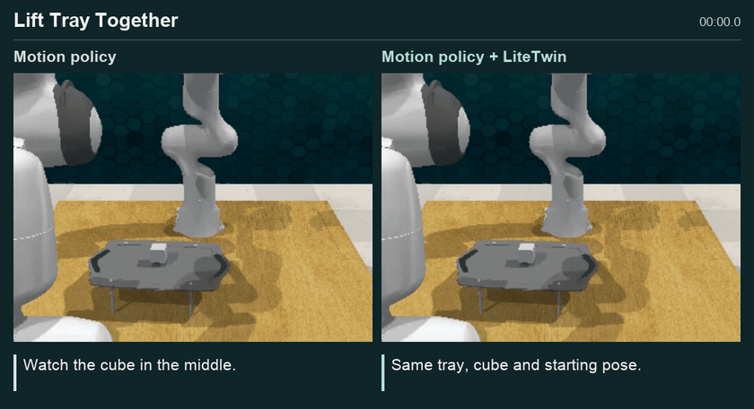
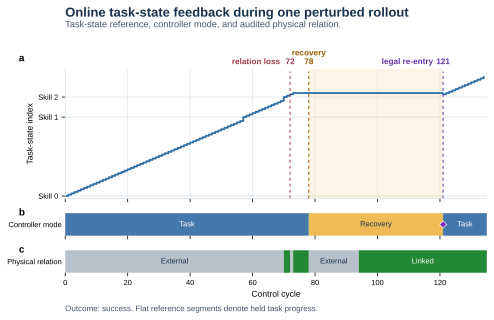

# LiteTwin

**English** · [简体中文](README.zh-Hans.md) · [繁體中文](README.zh-Hant.md)

**Task-state feedback for robot manipulation.** A gripper can follow its planned path after the object has slipped away. LiteTwin tracks the physical relation between hand and object alongside task progress. When the two disagree, it can hold the motion reference, recover contact and resume from a state supported by the scene.

[**Watch the paired rollouts →**](https://yukun-zheng.github.io/LiteTwin/?lang=en) · [Run Open Drawer](#run-open-drawer) · [Explore the policy](code/litetwin/policy/feedback/)

[](https://yukun-zheng.github.io/LiteTwin/?lang=en#bimanual_lift_tray)

*Follow the cube. Around 8 seconds, the left tray tips. On the right, both ends rise together with the cube still on board.*

## Three comparisons to watch

Watch the object as well as the gripper. Each row pairs the same initial scene, random seed and disturbance. The notes follow the action in two continuous, time-aligned recordings.

| Task | When to look | Motion policy | Motion policy + LiteTwin | Video |
| --- | --- | --- | --- | --- |
| [Lift a loaded tray](https://yukun-zheng.github.io/LiteTwin/?lang=en#bimanual_lift_tray) | 8–10 s | One end rises first and the tray tips back onto the table. | The tray stays level and the cube rises with it. | [MP4](https://yukun-zheng.github.io/LiteTwin/highlights/bimanual_lift_tray.en.mp4) |
| [Open a drawer](https://yukun-zheng.github.io/LiteTwin/?lang=en#open_drawer_delay) | 6–8 s | The arm moves away. The top drawer stays shut. | The gripper pulls the top drawer open in the same time window. | [MP4](https://yukun-zheng.github.io/LiteTwin/highlights/open_drawer_delay.en.mp4) |
| [Put the lid on a jar](https://yukun-zheng.github.io/LiteTwin/?lang=en#close_jar) | 7–16 s | The empty gripper reaches the jar. The gray lid stays on the table. | After the missed pickup, the gripper takes the lid to the red jar. | [MP4](https://yukun-zheng.github.io/LiteTwin/highlights/close_jar.en.mp4) |

<details><summary>Explore all 12 tasks and 13 recorded pairs</summary>

The gallery also includes episodes where both controllers finish or both fall short. Open Drawer has two recordings with different disturbances. The runnable example below uses the contact-loss episode.

<table>
  <tr>
    <td width="33%" align="center"><a href="https://yukun-zheng.github.io/LiteTwin/?lang=en#open_drawer"><br>Open Drawer</a></td>
    <td width="33%" align="center"><a href="https://yukun-zheng.github.io/LiteTwin/?lang=en#insert_square_peg"><br>Fit Ring onto Peg</a></td>
    <td width="33%" align="center"><a href="https://yukun-zheng.github.io/LiteTwin/?lang=en#handover_item"><br>Handover Item</a></td>
  </tr>
  <tr>
    <td width="33%" align="center"><a href="https://yukun-zheng.github.io/LiteTwin/?lang=en#stack_cups"><br>Stack Cups</a></td>
    <td width="33%" align="center"><a href="https://yukun-zheng.github.io/LiteTwin/?lang=en#close_jar"><br>Close Jar</a></td>
    <td width="33%" align="center"><a href="https://yukun-zheng.github.io/LiteTwin/?lang=en#place_cups_3"><br>Hang Three Cups</a></td>
  </tr>
  <tr>
    <td width="33%" align="center"><a href="https://yukun-zheng.github.io/LiteTwin/?lang=en#remove_cups_2"><br>Remove Two Cups</a></td>
    <td width="33%" align="center"><a href="https://yukun-zheng.github.io/LiteTwin/?lang=en#push_buttons_2"><br>Press Two Buttons</a></td>
    <td width="33%" align="center"><a href="https://yukun-zheng.github.io/LiteTwin/?lang=en#sweep_to_dustpan"><br>Sweep into Dustpan</a></td>
  </tr>
  <tr>
    <td width="33%" align="center"><a href="https://yukun-zheng.github.io/LiteTwin/?lang=en#bimanual_lift_tray"><br>Lift Tray Together</a></td>
    <td width="33%" align="center"><a href="https://yukun-zheng.github.io/LiteTwin/?lang=en#bimanual_put_bottle_in_fridge"><br>Put Bottle in Fridge</a></td>
    <td width="33%" align="center"><a href="https://yukun-zheng.github.io/LiteTwin/?lang=en#bimanual_sweep_to_dustpan"><br>Sweep with Two Arms</a></td>
  </tr>
</table>

Open any of the [26 individual recordings](docs/media/) from the player. To run the gallery locally, use `python -m http.server 8000 --directory docs` and open `http://localhost:8000`.

</details>

## Run Open Drawer

### 1. Build the model from five demonstrations

From the repository root, create the policy environment and run the offline stage. This stage uses the bundled low-dimensional trajectories and frozen motion checkpoint. It runs on CPU and needs no simulator.

```bash
conda env create -f demo/environment-policy.yml
conda activate litetwin-policy
python -m pip install -e ./code
export LITETWIN_POLICY_PYTHON="$(python -c 'import sys; print(sys.executable)')"
bash demo/run_offline.sh
```

The five demonstrations have different lengths but share **three ordered skills**. The fitted model has **101 task states** distributed **59 / 15 / 27**, two guarded boundaries and one recovery anchor. The [segmentation plot](docs/figures/task-structure.svg) shows the measured boundaries for each trajectory. Inspect the same values in `outputs/offline/model_summary.json` and the generated policy bundle in `outputs/models/litetwin/open_drawer/`.

### 2. Run the perturbed episode

Follow the [Linux simulator setup](demo/SETUP.md), then run the online stage from the same checkout.

```bash
bash demo/run_online.sh open_drawer
```

The launcher uses the saved model, starts a seeded RLBench scene, induces a loss of contact and records the run. It checks that the physical disturbance occurred and that RLBench reported completion. The output includes a continuous MP4, a JSON outcome, per-cycle records and an execution trace under `outputs/online/`. To rebuild and run both stages together, use `bash demo/run.sh open_drawer`. Rebuilding replaces the previous model and the online outputs derived from it.

### Read the execution trace



This trace comes from a fresh run of the packaged demo. Contact loss occurred at cycle **72**, recovery began at **78**, and the controller re-entered at **121**. RLBench reported success after **135 cycles**. The [cycle data](docs/figures/open-drawer-trace.csv) accompany the plot.

Read downward at the same control cycle. The line gives the **commanded task-state reference**, the middle strip gives the **controller mode**, and the lower strip records the **physical relation**. At re-entry the controller can deliberately return to an earlier supported state. The horizontal axis counts control cycles. The videos use elapsed playback time.

## Implementation

| Component | Role |
| --- | --- |
| [Task model](code/litetwin/policy/feedback/model/) | Align demonstrated skills and extract progress-indexed motion, relation and scene support. |
| [Inference](code/litetwin/policy/feedback/inference/) | Update the relation and progress estimates from observations and executed actions. |
| [Control](code/litetwin/policy/feedback/control/) | Decide when to hold, advance or cross a skill boundary. |
| [Recovery](code/litetwin/policy/feedback/recovery/) | Verify contact, repair a mismatch and choose a supported re-entry state. |
| [RLBench integration](code/integrations/rlbench/rlbench_litetwin/) | Connect the policy to observations, perturbations and simulator actions. |

The action backbone is a frozen object-centric DynaMAC implementation. LiteTwin supplies task-state feedback around that backbone. The [core API](code/litetwin/policy/feedback/README.md) describes the policy lifecycle and interfaces.

## License

LiteTwin's original code is available under the [MIT License](LICENSE). External simulator components retain their upstream licenses. See the [third-party notices and pinned revisions](code/integrations/rlbench/THIRD_PARTY.md).
