<p align="center"><b>English</b> &nbsp; · &nbsp; <a href="README.zh-Hans.md">简体中文</a> &nbsp; · &nbsp; <a href="README.zh-Hant.md">繁體中文</a></p>

<p align="center">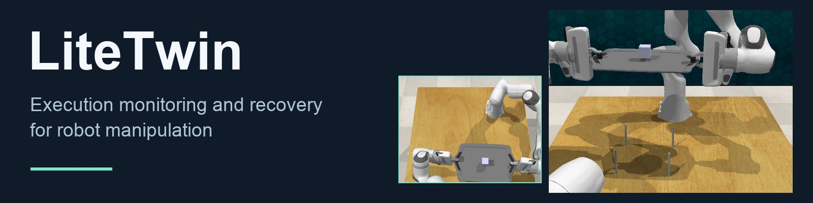</p>

<p align="center"><a href="#demos">Demos</a> &nbsp; · &nbsp; <a href="#how-it-works">How it works</a> &nbsp; · &nbsp; <a href="#quickstart">Quick start</a> &nbsp; · &nbsp; <a href="#code">Code</a> &nbsp; · &nbsp; <a href="#license">License</a></p>

LiteTwin tracks task progress and gripper–object contact alongside a frozen motion policy. When contact breaks, it can hold the motion reference, recover the interaction and resume execution.

<a id="demos"></a>

## See the object reach its goal

Selected RLBench simulation episodes. Each pair shares its initial scene and disturbance. Outcome labels use the simulator’s task condition for the displayed episode.

### Lift Tray Together

Lift the tray with the cube aboard.

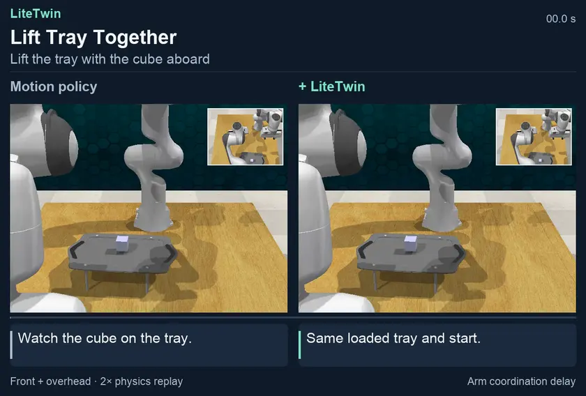

[**Full MP4 ↗**](https://yukun-zheng.github.io/LiteTwin/demos/bimanual_lift_tray.en.mp4) &nbsp; · &nbsp; [Original recordings](docs/recordings/bimanual_lift_tray/) &nbsp; · &nbsp; [JSON](docs/demos/bimanual_lift_tray.json)

### Open Drawer · Delayed Action

Open the top drawer despite the actuation delay.

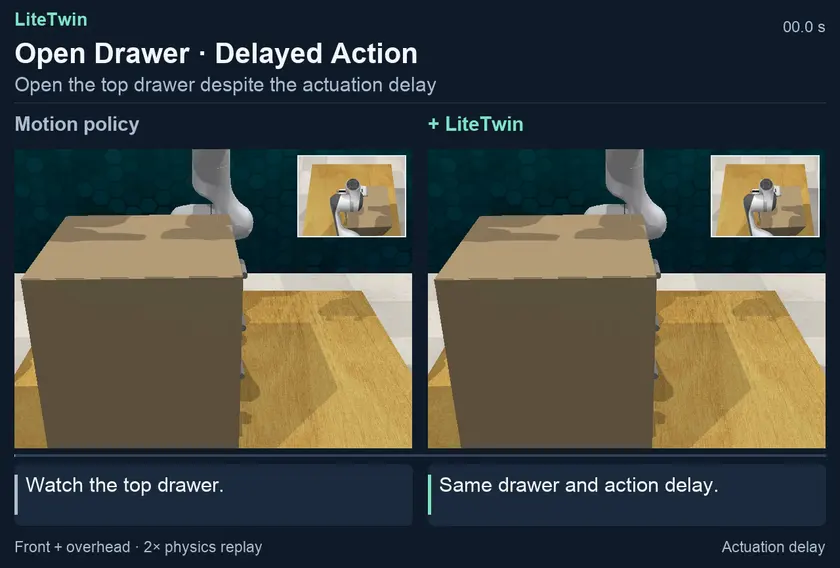

[**Full MP4 ↗**](https://yukun-zheng.github.io/LiteTwin/demos/open_drawer_delay.en.mp4) &nbsp; · &nbsp; [Original recordings](docs/recordings/open_drawer_delay/) &nbsp; · &nbsp; [JSON](docs/demos/open_drawer_delay.json)

### Recover the Jar Lid

Bring the gray lid to the red jar opening.

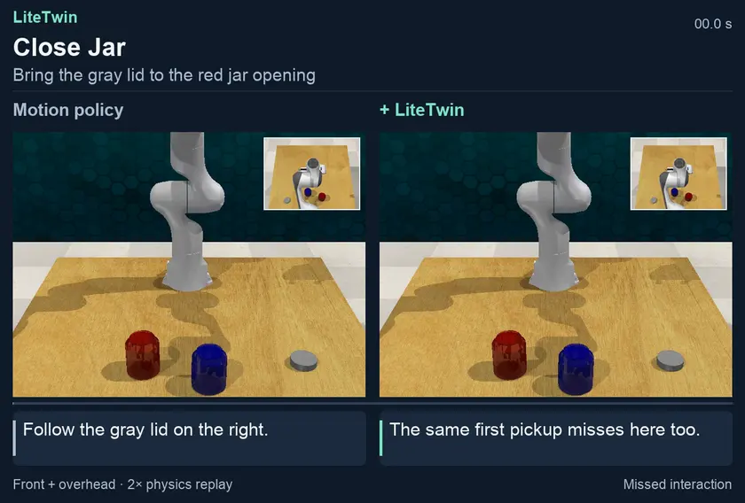

[**Full MP4 ↗**](https://yukun-zheng.github.io/LiteTwin/demos/close_jar.en.mp4) &nbsp; · &nbsp; [Original recordings](docs/recordings/close_jar/) &nbsp; · &nbsp; [JSON](docs/demos/close_jar.json)

Each animation follows the complete recorded action sequence and ends with a three-second detail of the recorded final frame. A shorter side holds its final frame. The full MP4 retains the source frame rate.

## More multi-step tasks

### Hang Three Cups

Hang three cups on the rack.

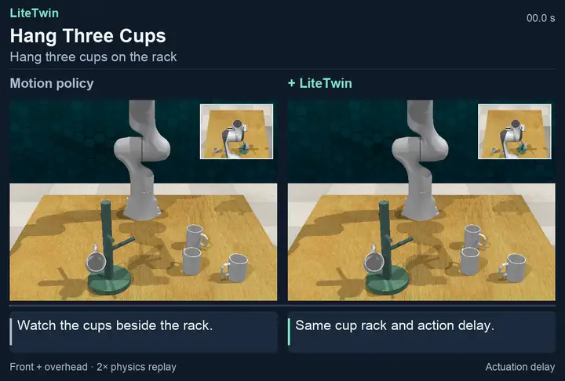

[**Full MP4 ↗**](https://yukun-zheng.github.io/LiteTwin/demos/place_cups_3.en.mp4) &nbsp; · &nbsp; [Original recordings](docs/recordings/place_cups_3/) &nbsp; · &nbsp; [JSON](docs/demos/place_cups_3.json)

### Press Three Buttons

Press all three buttons in order.

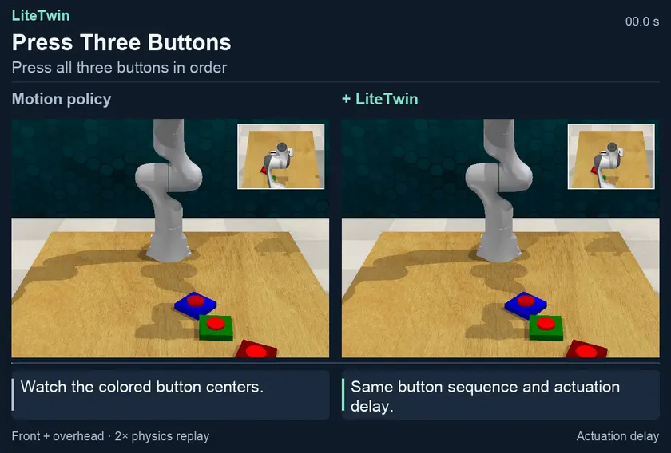

[**Full MP4 ↗**](https://yukun-zheng.github.io/LiteTwin/demos/push_buttons_3.en.mp4) &nbsp; · &nbsp; [Original recordings](docs/recordings/push_buttons_3/) &nbsp; · &nbsp; [JSON](docs/demos/push_buttons_3.json)

### Put Bottle in Fridge

Open the fridge and place the green bottle inside.

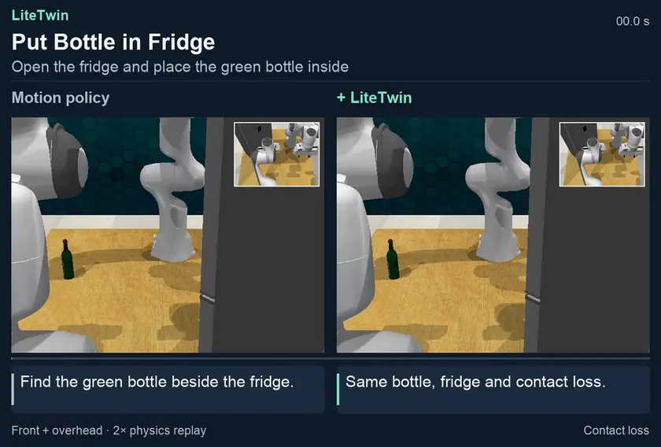

[**Full MP4 ↗**](https://yukun-zheng.github.io/LiteTwin/demos/bimanual_put_bottle_in_fridge.en.mp4) &nbsp; · &nbsp; [Original recordings](docs/recordings/bimanual_put_bottle_in_fridge/) &nbsp; · &nbsp; [JSON](docs/demos/bimanual_put_bottle_in_fridge.json)

<details>
<summary><b>Explore seven more recovery demonstrations</b></summary>

### Handover Item

Transfer the green cube between the two grippers.

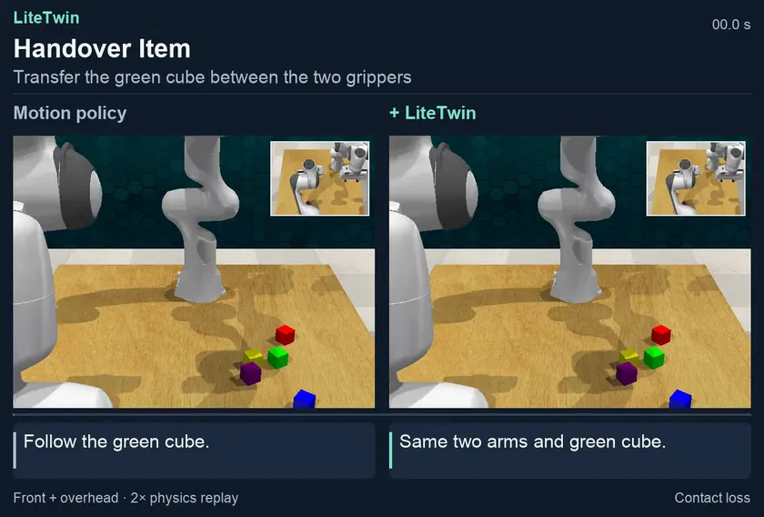

[**Full MP4 ↗**](https://yukun-zheng.github.io/LiteTwin/demos/handover_item.en.mp4) &nbsp; · &nbsp; [Original recordings](docs/recordings/handover_item/) &nbsp; · &nbsp; [JSON](docs/demos/handover_item.json)

### Fit Ring onto Peg

Fit the blue square ring onto the target peg.

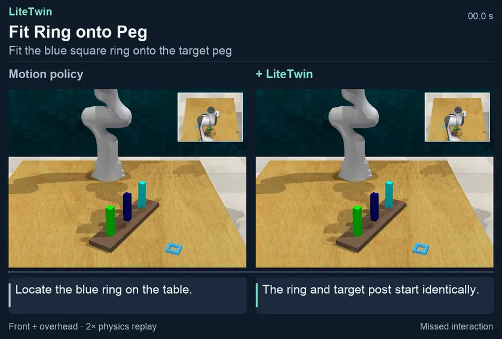

[**Full MP4 ↗**](https://yukun-zheng.github.io/LiteTwin/demos/insert_square_peg.en.mp4) &nbsp; · &nbsp; [Original recordings](docs/recordings/insert_square_peg/) &nbsp; · &nbsp; [JSON](docs/demos/insert_square_peg.json)

### Stack Cups

Stack all three cups.

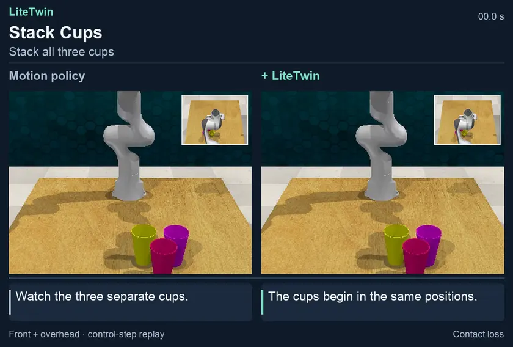

[**Full MP4 ↗**](https://yukun-zheng.github.io/LiteTwin/demos/stack_cups.en.mp4) &nbsp; · &nbsp; [Original recordings](docs/media/stack_cups/) &nbsp; · &nbsp; [JSON](docs/demos/stack_cups.json)

### Remove Two Cups

Remove two cups after the scene changes.

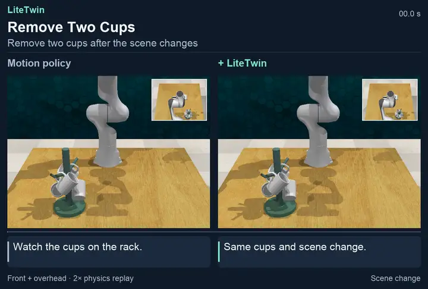

[**Full MP4 ↗**](https://yukun-zheng.github.io/LiteTwin/demos/remove_cups_2.en.mp4) &nbsp; · &nbsp; [Original recordings](docs/recordings/remove_cups_2/) &nbsp; · &nbsp; [JSON](docs/demos/remove_cups_2.json)

### Sweep into Dustpan

Sweep the debris into the dustpan.

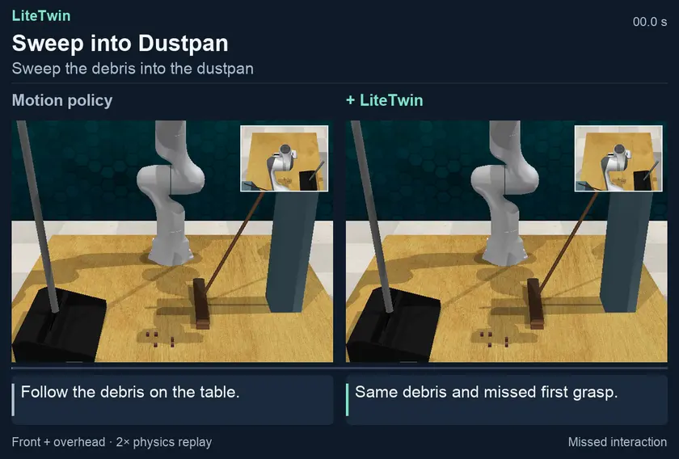

[**Full MP4 ↗**](https://yukun-zheng.github.io/LiteTwin/demos/sweep_to_dustpan_recovery.en.mp4) &nbsp; · &nbsp; [Original recordings](docs/recordings/sweep_to_dustpan_recovery/) &nbsp; · &nbsp; [JSON](docs/demos/sweep_to_dustpan_recovery.json)

### Sweep with Two Arms

Sweep the debris into the dustpan.

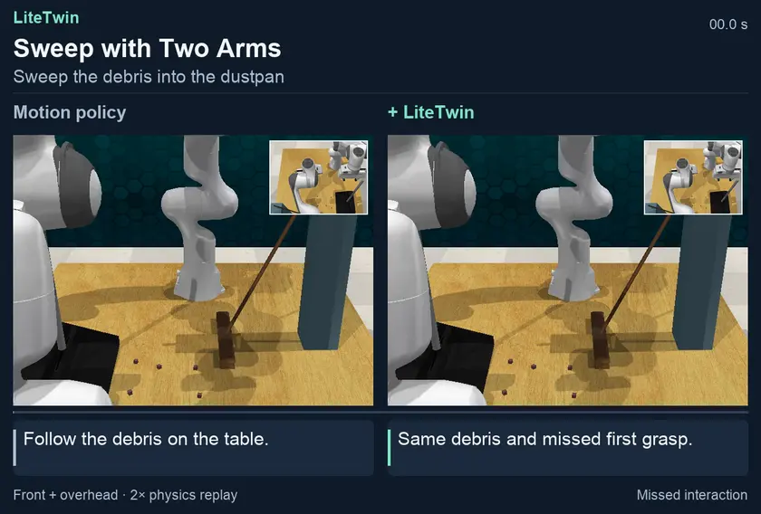

[**Full MP4 ↗**](https://yukun-zheng.github.io/LiteTwin/demos/bimanual_sweep_to_dustpan.en.mp4) &nbsp; · &nbsp; [Original recordings](docs/recordings/bimanual_sweep_to_dustpan/) &nbsp; · &nbsp; [JSON](docs/demos/bimanual_sweep_to_dustpan.json)

### Open Drawer

Recover contact and pull the drawer to its goal.

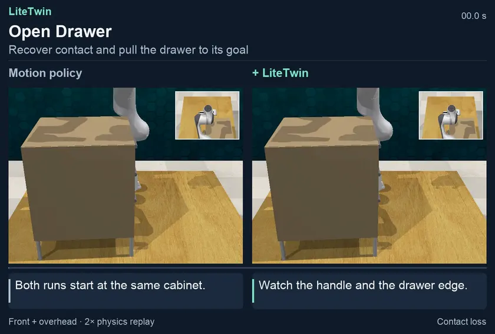

[**Full MP4 ↗**](https://yukun-zheng.github.io/LiteTwin/demos/open_drawer.en.mp4) &nbsp; · &nbsp; [Original recordings](docs/recordings/open_drawer/) &nbsp; · &nbsp; [JSON](docs/demos/open_drawer.json)

</details>

<a id="how-it-works"></a>

## How LiteTwin works

<table>
<tr><td width="33%" valign="top"><b>Track the task</b><br><br>Estimate progress and contact relations from observations.</td><td width="33%" valign="top"><b>Check the interaction</b><br><br>Hold the motion reference when the expected interaction is unsupported.</td><td width="33%" valign="top"><b>Recover and resume</b><br><br>Re-establish contact and re-enter a supported task state.</td></tr>
</table>

<a id="quickstart"></a>

## Run it yourself

Install the policy environment and build a task model from the five included Open Drawer demonstrations.

```bash
git clone https://github.com/Yukun-Zheng/LiteTwin.git
cd LiteTwin
conda env create -f demo/environment-policy.yml
conda activate litetwin-policy
python -m pip install -e ./code
bash demo/run_offline.sh
```

<details>
<summary><b>Quick start · Open Drawer / RLBench</b></summary>

## Run Open Drawer

### 1. Build the model from five demonstrations

From the repository root, create the policy environment and run the offline stage. This stage uses the bundled low-dimensional trajectories and frozen motion checkpoint. It runs on CPU and needs no simulator.

```bash
conda env create -f demo/environment-policy.yml
conda activate litetwin-policy
python -m pip install -e ./code
export LITETWIN_POLICY_PYTHON="$(python -c 'import sys; print(sys.executable)')"
bash demo/run_offline.sh
```

The five demonstrations have different lengths but share **three ordered skills**. The fitted model has **101 task states** distributed **59 / 15 / 27**, two guarded boundaries and one recovery anchor. The [segmentation plot](docs/figures/task-structure.svg) shows the measured boundaries for each trajectory. Inspect the same values in `outputs/offline/model_summary.json` and the generated policy bundle in `outputs/models/litetwin/open_drawer/`.

### 2. Run the perturbed episode

Follow the [Linux simulator setup](demo/SETUP.md), then run the online stage from the same checkout.

```bash
bash demo/run_online.sh open_drawer
```

The launcher uses the saved model, starts a seeded RLBench scene, induces a loss of contact and records the run. It checks that the physical disturbance occurred and that RLBench reported completion. The output includes a continuous MP4, a JSON outcome, per-cycle records and an execution trace under `outputs/online/`. To rebuild and run both stages together, use `bash demo/run.sh open_drawer`. Rebuilding replaces the previous model and the online outputs derived from it.

### Read the execution trace


This trace comes from a fresh run of the packaged demo. Contact loss occurred at cycle **72**, recovery began at **78**, and the controller re-entered at **121**. RLBench reported success after **135 cycles**. The [cycle data](docs/figures/open-drawer-trace.csv) accompany the plot.

Read downward at the same control cycle. The line gives the **commanded task-state reference**, the middle strip gives the **controller mode**, and the lower strip records the **physical relation**. At re-entry the controller can deliberately return to an earlier supported state. The horizontal axis counts control cycles. The videos use elapsed playback time.

</details>

<a id="code"></a>

## Code structure

- [Task model](code/litetwin/policy/feedback/model/)
- [State inference](code/litetwin/policy/feedback/inference/)
- [Execution control](code/litetwin/policy/feedback/control/)
- [Recovery](code/litetwin/policy/feedback/recovery/)
- [RLBench integration](code/integrations/rlbench/rlbench_litetwin/)

[Policy API](code/litetwin/policy/feedback/README.md) · [DynaMAC](code/litetwin/policy/dynamac.py)

<details>
<summary>Recording identities and outcomes</summary>

Per-task JSON files list the original-video hashes, frame counts, displayed outcomes and playback-copy hashes. All action frames remain in order. The final detail is cropped from the recorded terminal frame.

[JSON](docs/demos/)

</details>

<details>
<summary>Additional recorded outcomes</summary>

The retained recordings include a two-button episode that both methods complete and a separate single-arm sweep that neither method completes. These provide additional context for the selected examples.

### Press Two Buttons

Press both buttons in order.

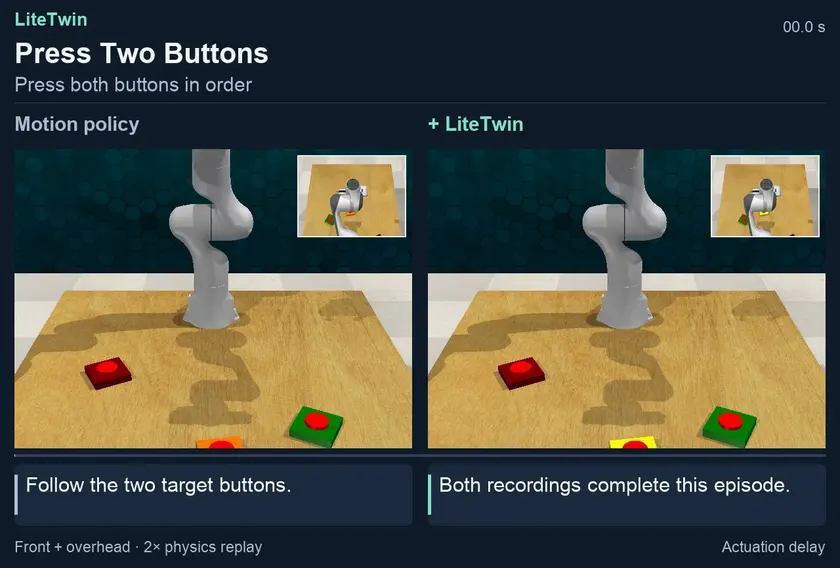

[**Full MP4 ↗**](https://yukun-zheng.github.io/LiteTwin/demos/push_buttons_2.en.mp4) &nbsp; · &nbsp; [Original recordings](docs/recordings/push_buttons_2/) &nbsp; · &nbsp; [JSON](docs/demos/push_buttons_2.json)

### Sweep into Dustpan

Sweep the debris into the dustpan.

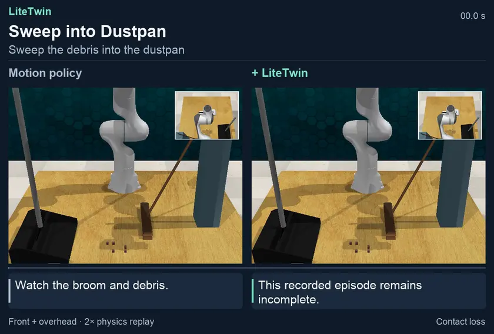

[**Full MP4 ↗**](https://yukun-zheng.github.io/LiteTwin/demos/sweep_to_dustpan.en.mp4) &nbsp; · &nbsp; [Original recordings](docs/recordings/sweep_to_dustpan/) &nbsp; · &nbsp; [JSON](docs/demos/sweep_to_dustpan.json)

</details>

<a id="license"></a>

## License

LiteTwin's original code is available under the [MIT License](LICENSE). External simulator components retain their upstream licenses. See the [third-party notices and pinned revisions](code/integrations/rlbench/THIRD_PARTY.md).
