<p align="center"><a href="README.md">English</a> &nbsp; · &nbsp; <b>简体中文</b> &nbsp; · &nbsp; <a href="README.zh-Hant.md">繁體中文</a></p>

<p align="center">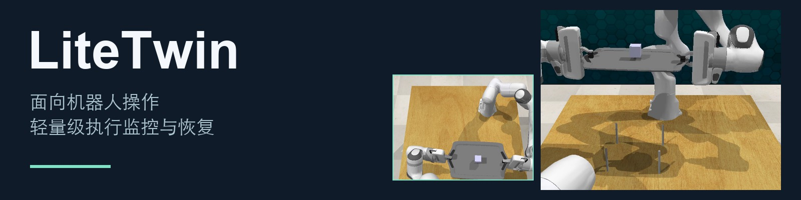</p>

<p align="center"><a href="#demos">观看演示</a> &nbsp; · &nbsp; <a href="#how-it-works">工作原理</a> &nbsp; · &nbsp; <a href="#quickstart">快速开始</a> &nbsp; · &nbsp; <a href="#code">代码</a> &nbsp; · &nbsp; <a href="#license">许可证</a></p>

LiteTwin 在冻结的运动策略上跟踪任务进度及夹爪与物体的接触关系。接触丢失时，它可以保持运动参考、恢复交互，再从受支持的任务状态继续执行。

<a id="demos"></a>

## 让物体真正到达任务目标

以下为精选 RLBench 仿真回合。每组两侧使用相同的初始场景和扰动，结果标注以当前回合的仿真器任务条件为准。

### 双臂抬托盘

保持方块在托盘内，双臂共同抬起。

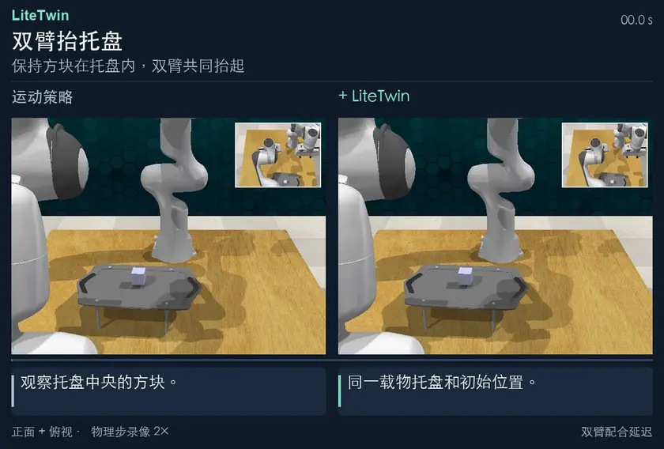

[**完整 MP4 ↗**](https://yukun-zheng.github.io/LiteTwin/demos/bimanual_lift_tray.zh-Hans.mp4) &nbsp; · &nbsp; [原始录像](docs/recordings/bimanual_lift_tray/) &nbsp; · &nbsp; [JSON](docs/demos/bimanual_lift_tray.json)

### 打开抽屉 · 动作延迟

动作延迟后，仍将最上层抽屉拉开。

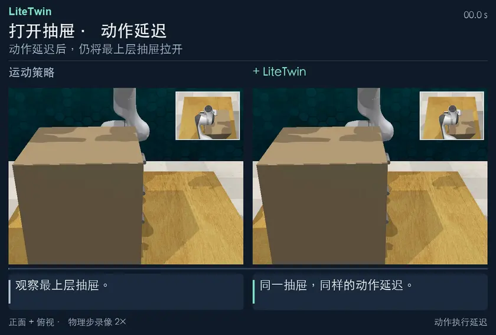

[**完整 MP4 ↗**](https://yukun-zheng.github.io/LiteTwin/demos/open_drawer_delay.zh-Hans.mp4) &nbsp; · &nbsp; [原始录像](docs/recordings/open_drawer_delay/) &nbsp; · &nbsp; [JSON](docs/demos/open_drawer_delay.json)

### 抓回罐盖并送至罐口

首次抓取落空后，将灰盖送到红色罐口。

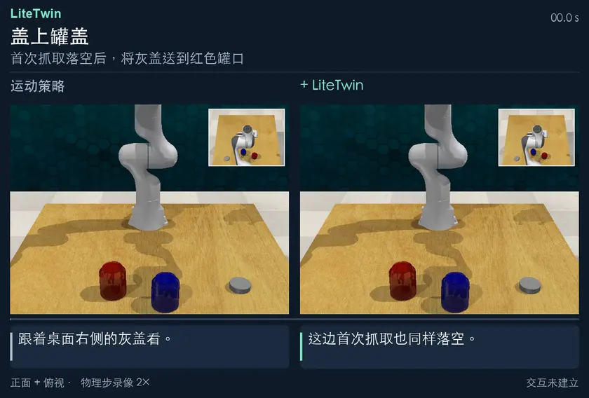

[**完整 MP4 ↗**](https://yukun-zheng.github.io/LiteTwin/demos/close_jar.zh-Hans.mp4) &nbsp; · &nbsp; [原始录像](docs/recordings/close_jar/) &nbsp; · &nbsp; [JSON](docs/demos/close_jar.json)

每段动图保留完整记录动作，结尾用三秒展示记录终帧的物体局部。较短的一侧停在其最后一帧。完整 MP4 保留原始录像帧率。

## 更多多阶段任务

### 挂起三个杯子

将三个杯子依次挂到杯架上。

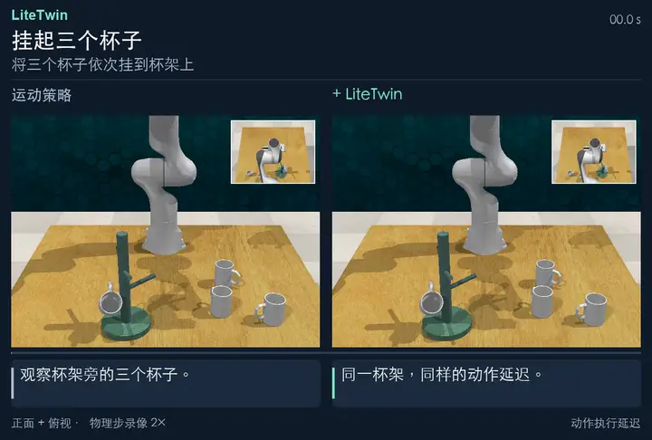

[**完整 MP4 ↗**](https://yukun-zheng.github.io/LiteTwin/demos/place_cups_3.zh-Hans.mp4) &nbsp; · &nbsp; [原始录像](docs/recordings/place_cups_3/) &nbsp; · &nbsp; [JSON](docs/demos/place_cups_3.json)

### 依次按下三个按钮

克服动作延迟，依次按下三个按钮。

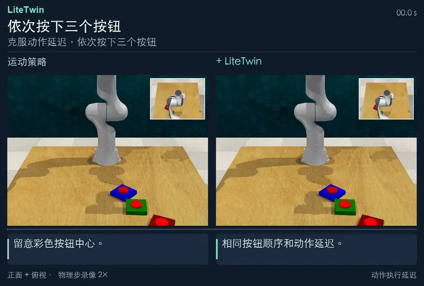

[**完整 MP4 ↗**](https://yukun-zheng.github.io/LiteTwin/demos/push_buttons_3.zh-Hans.mp4) &nbsp; · &nbsp; [原始录像](docs/recordings/push_buttons_3/) &nbsp; · &nbsp; [JSON](docs/demos/push_buttons_3.json)

### 把瓶子放进冰箱

双臂配合开门，将绿色瓶子放入冰箱。

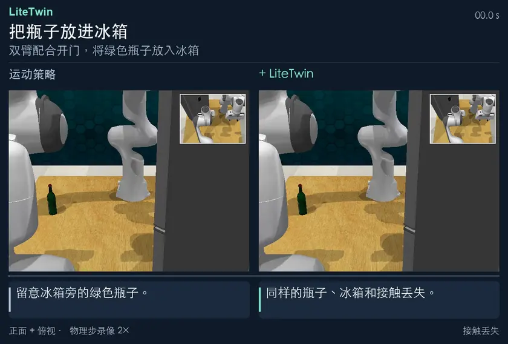

[**完整 MP4 ↗**](https://yukun-zheng.github.io/LiteTwin/demos/bimanual_put_bottle_in_fridge.zh-Hans.mp4) &nbsp; · &nbsp; [原始录像](docs/recordings/bimanual_put_bottle_in_fridge/) &nbsp; · &nbsp; [JSON](docs/demos/bimanual_put_bottle_in_fridge.json)

<details>
<summary><b>展开另外七组恢复演示</b></summary>

### 双臂交接物体

双臂交接绿色方块。

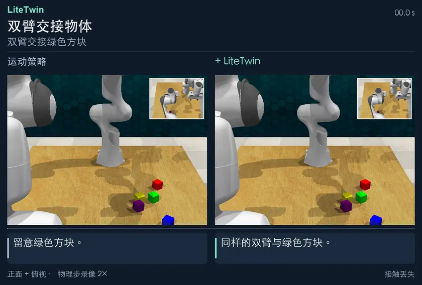

[**完整 MP4 ↗**](https://yukun-zheng.github.io/LiteTwin/demos/handover_item.zh-Hans.mp4) &nbsp; · &nbsp; [原始录像](docs/recordings/handover_item/) &nbsp; · &nbsp; [JSON](docs/demos/handover_item.json)

### 方环套柱

抓起蓝色方环并套到目标柱上。

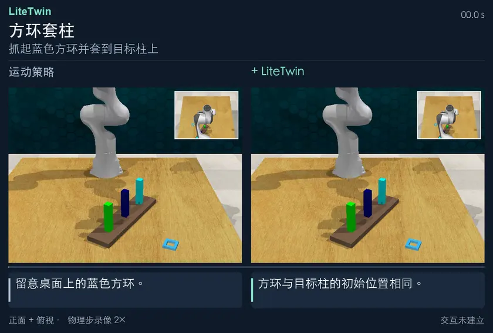

[**完整 MP4 ↗**](https://yukun-zheng.github.io/LiteTwin/demos/insert_square_peg.zh-Hans.mp4) &nbsp; · &nbsp; [原始录像](docs/recordings/insert_square_peg/) &nbsp; · &nbsp; [JSON](docs/demos/insert_square_peg.json)

### 叠放杯子

将三个杯子依次叠放。

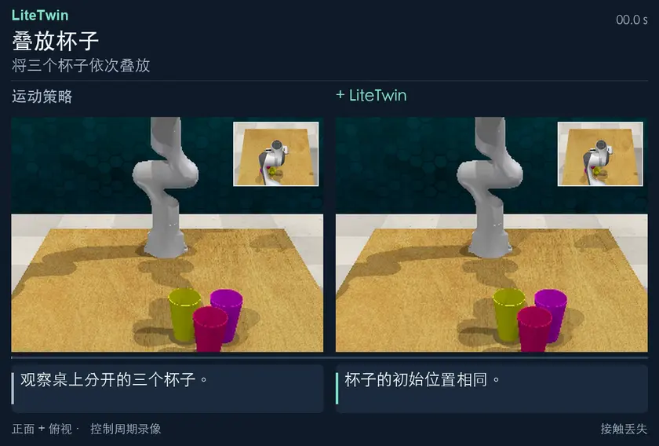

[**完整 MP4 ↗**](https://yukun-zheng.github.io/LiteTwin/demos/stack_cups.zh-Hans.mp4) &nbsp; · &nbsp; [原始录像](docs/media/stack_cups/) &nbsp; · &nbsp; [JSON](docs/demos/stack_cups.json)

### 取下两个杯子

场景变化后，将两个杯子从杯架取下。

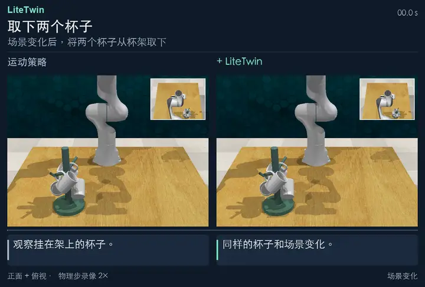

[**完整 MP4 ↗**](https://yukun-zheng.github.io/LiteTwin/demos/remove_cups_2.zh-Hans.mp4) &nbsp; · &nbsp; [原始录像](docs/recordings/remove_cups_2/) &nbsp; · &nbsp; [JSON](docs/demos/remove_cups_2.json)

### 将碎屑扫入簸箕

恢复扫把抓取，将碎屑扫入簸箕。

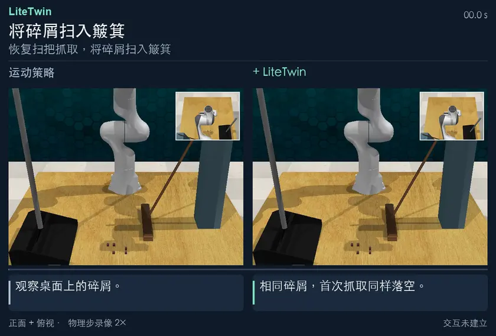

[**完整 MP4 ↗**](https://yukun-zheng.github.io/LiteTwin/demos/sweep_to_dustpan_recovery.zh-Hans.mp4) &nbsp; · &nbsp; [原始录像](docs/recordings/sweep_to_dustpan_recovery/) &nbsp; · &nbsp; [JSON](docs/demos/sweep_to_dustpan_recovery.json)

### 双臂配合清扫

恢复扫把抓取，将碎屑扫入簸箕。

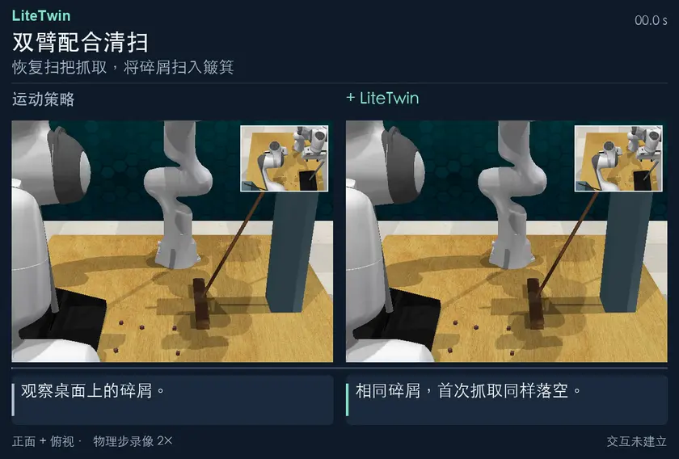

[**完整 MP4 ↗**](https://yukun-zheng.github.io/LiteTwin/demos/bimanual_sweep_to_dustpan.zh-Hans.mp4) &nbsp; · &nbsp; [原始录像](docs/recordings/bimanual_sweep_to_dustpan/) &nbsp; · &nbsp; [JSON](docs/demos/bimanual_sweep_to_dustpan.json)

### 打开抽屉

接触丢失后，重新拉动抽屉至目标位置。

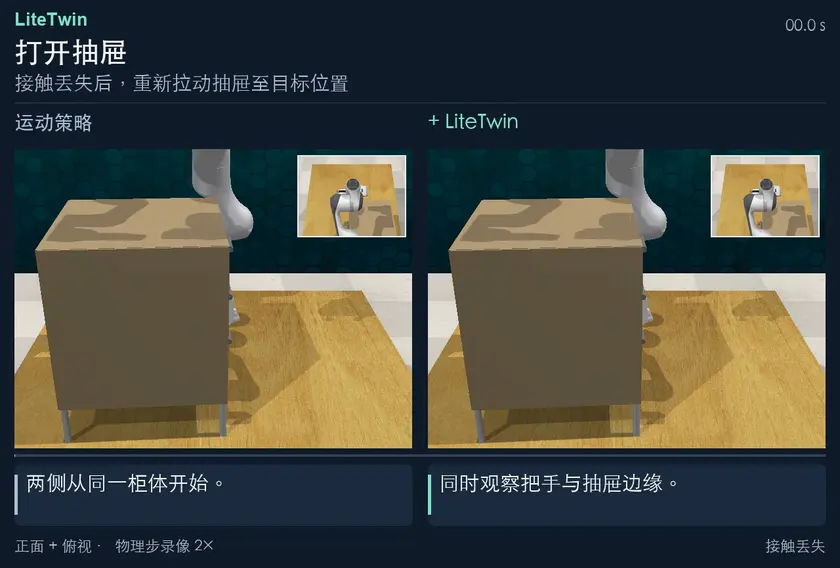

[**完整 MP4 ↗**](https://yukun-zheng.github.io/LiteTwin/demos/open_drawer.zh-Hans.mp4) &nbsp; · &nbsp; [原始录像](docs/recordings/open_drawer/) &nbsp; · &nbsp; [JSON](docs/demos/open_drawer.json)

</details>

<a id="how-it-works"></a>

## LiteTwin 如何工作

<table>
<tr><td width="33%" valign="top"><b>跟踪任务状态</b><br><br>从观测中估计任务进度和接触关系。</td><td width="33%" valign="top"><b>检查实际交互</b><br><br>预期交互尚未建立时，保持运动参考。</td><td width="33%" valign="top"><b>恢复后继续执行</b><br><br>重新建立接触，从受支持的状态重入任务。</td></tr>
</table>

<a id="quickstart"></a>

## 本地复现

安装策略环境，使用内附的五条开抽屉演示轨迹构建任务模型。

```bash
git clone https://github.com/Yukun-Zheng/LiteTwin.git
cd LiteTwin
conda env create -f demo/environment-policy.yml
conda activate litetwin-policy
python -m pip install -e ./code
bash demo/run_offline.sh
```

<details>
<summary><b>快速开始 · Open Drawer / RLBench</b></summary>

<a id="run-open-drawer"></a>

## 运行开抽屉示例

### 1. 从五条演示轨迹构建模型

在仓库根目录安装策略环境并运行离线阶段。此阶段使用内附的低维轨迹和冻结的运动策略检查点，在 CPU 上即可运行，无需安装仿真器。

```bash
conda env create -f demo/environment-policy.yml
conda activate litetwin-policy
python -m pip install -e ./code
export LITETWIN_POLICY_PYTHON="$(python -c 'import sys; print(sys.executable)')"
bash demo/run_offline.sh
```

五条轨迹长度不一，但共享三个有序技能。模型得到 **101 个任务状态**，三个技能分别有 **59、15、27** 个状态，另有两个带条件的技能边界和一个恢复锚点。可对照[轨迹分段图](docs/figures/task-structure.zh-Hans.svg)、`outputs/offline/model_summary.json` 和 `outputs/models/litetwin/open_drawer/` 下的模型。

### 2. 运行带扰动的回合

按 [Linux 仿真器安装说明](demo/SETUP.zh-Hans.md) 配置依赖，然后运行：

```bash
bash demo/run_online.sh open_drawer
```

程序加载生成的模型，在指定种子的 RLBench 场景中引入接触丢失，检查扰动是否实际发生、任务是否完成，并在 `outputs/online/` 下保存连续视频、JSON 结果、逐周期记录和时间线。运行 `bash demo/run.sh open_drawer` 可依次执行两个阶段。重新构建会替换之前的模型和关联的在线输出。

### 阅读控制时间线


一次复跑中，第 **72** 个控制周期发生接触丢失，第 **78** 个周期开始恢复，第 **121** 个周期重新进入受支持的任务状态，**135** 个周期后仿真器报告成功。上方曲线是指令给出的任务状态参考，中间色带是控制器模式，下方色带是观测到的物理接触。水平线表示进度保持。横轴以控制周期计，视频以播放时间计。[逐周期数据](docs/figures/open-drawer-trace.csv)

</details>

<a id="code"></a>

## 代码结构

- [任务模型](code/litetwin/policy/feedback/model/)
- [状态推断](code/litetwin/policy/feedback/inference/)
- [执行控制](code/litetwin/policy/feedback/control/)
- [交互恢复](code/litetwin/policy/feedback/recovery/)
- [RLBench 适配层](code/integrations/rlbench/rlbench_litetwin/)

[策略 API](code/litetwin/policy/feedback/README.md) · [DynaMAC](code/litetwin/policy/dynamac.py)

<details>
<summary>录像身份与结果记录</summary>

每个任务的 JSON 文件记录原视频哈希、帧数、展示结果及播放副本哈希。全部动作帧保持原有顺序，结尾的局部画面裁切自记录终帧。

[JSON](docs/demos/)

</details>

<details>
<summary>其他记录回合</summary>

原始记录中还保留了双方都完成的双按钮回合，以及双方都未完成的另一次单臂清扫回合，可结合精选演示一并查看。

### 按下两个按钮

依次按下两个按钮。

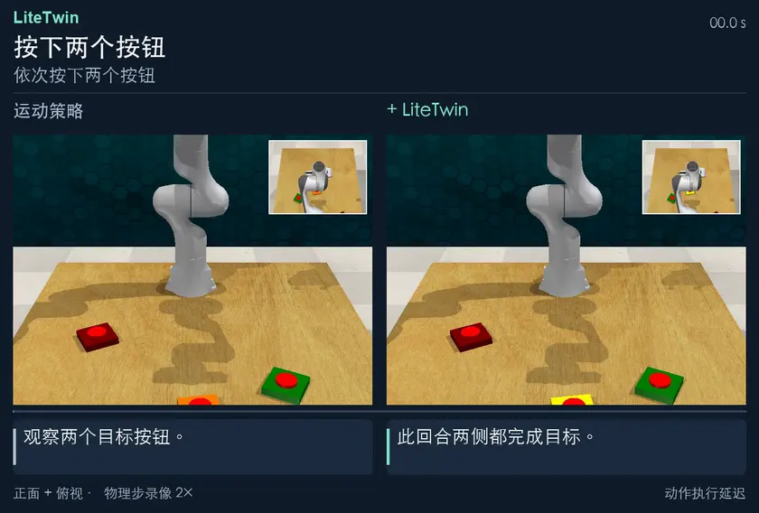

[**完整 MP4 ↗**](https://yukun-zheng.github.io/LiteTwin/demos/push_buttons_2.zh-Hans.mp4) &nbsp; · &nbsp; [原始录像](docs/recordings/push_buttons_2/) &nbsp; · &nbsp; [JSON](docs/demos/push_buttons_2.json)

### 单臂清扫

将碎屑扫入簸箕。

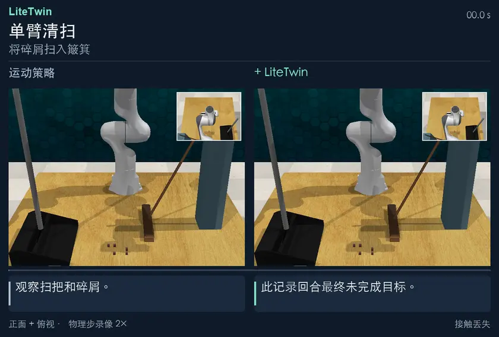

[**完整 MP4 ↗**](https://yukun-zheng.github.io/LiteTwin/demos/sweep_to_dustpan.zh-Hans.mp4) &nbsp; · &nbsp; [原始录像](docs/recordings/sweep_to_dustpan/) &nbsp; · &nbsp; [JSON](docs/demos/sweep_to_dustpan.json)

</details>

<a id="license"></a>

## 许可证

LiteTwin 原创代码采用 [MIT 许可证](LICENSE)。外部仿真组件沿用各自的上游许可，详见[第三方声明和固定版本](code/integrations/rlbench/THIRD_PARTY.md)。
