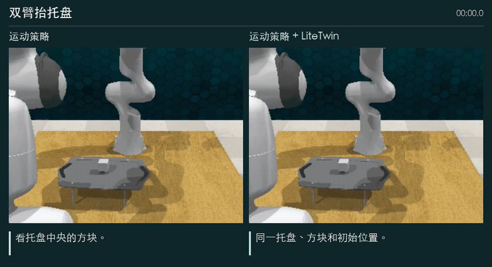
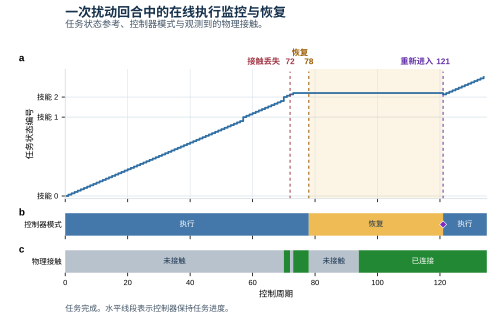

# LiteTwin

[English](README.md) · **简体中文** · [繁體中文](README.zh-Hant.md)

[**进入 LiteTwin 交互演示网站 →**](https://yukun-zheng.github.io/LiteTwin/?lang=zh-Hans) · [运行开抽屉示例](#run-open-drawer) · [查看策略实现](code/litetwin/policy/feedback/)

**面向机器人操作的任务状态反馈。** 物体从夹爪里滑落时，机械臂仍可能沿原轨迹前进。LiteTwin 同时跟踪任务进度与夹爪和物体的接触关系。两者不一致时，控制器可以暂停推进，恢复接触，再从当前场景支持的状态继续执行。

[](https://yukun-zheng.github.io/LiteTwin/?lang=zh-Hans#bimanual_lift_tray)

*盯住托盘中央的方块。约第 8 秒，左侧托盘开始倾倒；右侧两端随后一起升起，方块稳稳留在托盘上。*

## 三组值得对照看的动作

把视线放在物体上，看它有没有跟着夹爪移动。每组的初始场景、随机种子和扰动都相同。两侧录像从头同步播放，注释会随动作变化。

| 任务 | 观察时段 | 运动策略 | 运动策略 + LiteTwin | 录像 |
| --- | --- | --- | --- | --- |
| [双臂抬托盘](https://yukun-zheng.github.io/LiteTwin/?lang=zh-Hans#bimanual_lift_tray) | 8–10 秒 | 一端先抬起，托盘翻倒在桌上。 | 两端一起抬起，方块随托盘升高。 | [MP4](https://yukun-zheng.github.io/LiteTwin/highlights/bimanual_lift_tray.zh-Hans.mp4) |
| [打开抽屉](https://yukun-zheng.github.io/LiteTwin/?lang=zh-Hans#open_drawer_delay) | 6–8 秒 | 机械臂空手移开，最上层抽屉仍关着。 | 同一时段内，夹爪已把最上层抽屉拉开。 | [MP4](https://yukun-zheng.github.io/LiteTwin/highlights/open_drawer_delay.zh-Hans.mp4) |
| [盖上罐盖](https://yukun-zheng.github.io/LiteTwin/?lang=zh-Hans#close_jar) | 7–16 秒 | 空夹爪移到罐口，灰色盖子还在桌上。 | 首次抓取落空后重新抓住盖子，把它放到红罐上。 | [MP4](https://yukun-zheng.github.io/LiteTwin/highlights/close_jar.zh-Hans.mp4) |

<details><summary>展开全部 12 项任务、13 组配对录像</summary>

演示库也保留了双方都完成、双方都未完成的回合。打开抽屉有两组录像，扰动不同。下方可复跑的示例对应接触丢失的那一组。

<table>
  <tr>
    <td width="33%" align="center"><a href="https://yukun-zheng.github.io/LiteTwin/?lang=zh-Hans#open_drawer"><br>打开抽屉</a></td>
    <td width="33%" align="center"><a href="https://yukun-zheng.github.io/LiteTwin/?lang=zh-Hans#insert_square_peg"><br>方环套柱</a></td>
    <td width="33%" align="center"><a href="https://yukun-zheng.github.io/LiteTwin/?lang=zh-Hans#handover_item"><br>双臂交接物体</a></td>
  </tr>
  <tr>
    <td width="33%" align="center"><a href="https://yukun-zheng.github.io/LiteTwin/?lang=zh-Hans#stack_cups"><br>叠放杯子</a></td>
    <td width="33%" align="center"><a href="https://yukun-zheng.github.io/LiteTwin/?lang=zh-Hans#close_jar"><br>盖上罐盖</a></td>
    <td width="33%" align="center"><a href="https://yukun-zheng.github.io/LiteTwin/?lang=zh-Hans#place_cups_3"><br>挂起三个杯子</a></td>
  </tr>
  <tr>
    <td width="33%" align="center"><a href="https://yukun-zheng.github.io/LiteTwin/?lang=zh-Hans#remove_cups_2"><br>取下两个杯子</a></td>
    <td width="33%" align="center"><a href="https://yukun-zheng.github.io/LiteTwin/?lang=zh-Hans#push_buttons_2"><br>按下两个按钮</a></td>
    <td width="33%" align="center"><a href="https://yukun-zheng.github.io/LiteTwin/?lang=zh-Hans#sweep_to_dustpan"><br>单臂清扫</a></td>
  </tr>
  <tr>
    <td width="33%" align="center"><a href="https://yukun-zheng.github.io/LiteTwin/?lang=zh-Hans#bimanual_lift_tray"><br>双臂抬托盘</a></td>
    <td width="33%" align="center"><a href="https://yukun-zheng.github.io/LiteTwin/?lang=zh-Hans#bimanual_put_bottle_in_fridge"><br>把瓶子放进冰箱</a></td>
    <td width="33%" align="center"><a href="https://yukun-zheng.github.io/LiteTwin/?lang=zh-Hans#bimanual_sweep_to_dustpan"><br>双臂配合清扫</a></td>
  </tr>
</table>

播放器内可单独打开全部 [26 段原视角录像](docs/media/)。在仓库根目录运行 `python -m http.server 8000 --directory docs`，然后打开 `http://localhost:8000`。

</details>

<a id="run-open-drawer"></a>

## 运行开抽屉示例

### 1. 从五条演示轨迹构建模型

在仓库根目录安装策略环境并运行离线阶段。此阶段使用内附的低维轨迹和冻结的运动策略检查点，在 CPU 上即可运行，无需安装仿真器。

```bash
conda env create -f demo/environment-policy.yml
conda activate litetwin-policy
python -m pip install -e ./code
export LITETWIN_POLICY_PYTHON="$(python -c 'import sys; print(sys.executable)')"
bash demo/run_offline.sh
```

五条轨迹长度不一，但共享三个有序技能。模型得到 **101 个任务状态**，三个技能分别有 **59、15、27** 个状态，另有两个带条件的技能边界和一个恢复锚点。可对照[轨迹分段图](docs/figures/task-structure.zh-Hans.svg)、`outputs/offline/model_summary.json` 和 `outputs/models/litetwin/open_drawer/` 下的模型。

### 2. 运行带扰动的回合

按 [Linux 仿真器安装说明](demo/SETUP.zh-Hans.md) 配置依赖，然后运行：

```bash
bash demo/run_online.sh open_drawer
```

程序加载生成的模型，在指定种子的 RLBench 场景中引入接触丢失，检查扰动是否实际发生、任务是否完成，并在 `outputs/online/` 下保存连续视频、JSON 结果、逐周期记录和时间线。运行 `bash demo/run.sh open_drawer` 可依次执行两个阶段。重新构建会替换之前的模型和关联的在线输出。

### 阅读控制时间线



一次复跑中，第 **72** 个控制周期发生接触丢失，第 **78** 个周期开始恢复，第 **121** 个周期重新进入受支持的任务状态，**135** 个周期后仿真器报告成功。上方曲线是指令给出的任务状态参考，中间色带是控制器模式，下方色带是观测到的物理接触。水平线表示进度保持。横轴以控制周期计，视频以播放时间计。[逐周期数据](docs/figures/open-drawer-trace.csv)

## 代码结构

[任务模型](code/litetwin/policy/feedback/model/) 从演示中提取技能边界、物体关系和场景约束。[推断](code/litetwin/policy/feedback/inference/) 更新进度与关系估计，[控制](code/litetwin/policy/feedback/control/) 决定保持、推进或跨越技能边界，[恢复](code/litetwin/policy/feedback/recovery/) 负责验证接触、重新获取物体和选择重入状态。[RLBench 适配层](code/integrations/rlbench/rlbench_litetwin/) 连接观测、扰动和仿真器动作。底层动作参考由冻结的 DynaMAC 运动策略提供。

## 许可证

LiteTwin 原创代码采用 [MIT 许可证](LICENSE)。外部仿真组件沿用各自的上游许可，详见[第三方声明和固定版本](code/integrations/rlbench/THIRD_PARTY.md)。
