# LiteTwin

[English](README.md) · [简体中文](README.zh-Hans.md) · **繁體中文**

**用於機器人操作的任務狀態回饋**

LiteTwin 在凍結的運動策略上追蹤任務進度，以及夾爪與物體的接觸關係。當機械臂沿軌跡前進、物體卻留在原地時，控制器可以暫停推進，恢復接觸，再繼續執行任務。

[互動示範](https://yukun-zheng.github.io/LiteTwin/?lang=zh-Hant) · [快速開始](#quickstart) · [策略 API](code/litetwin/policy/feedback/README.md) · [MIT 授權條款](LICENSE)

<a id="film"></a>

## 專案短片 · 40 秒

[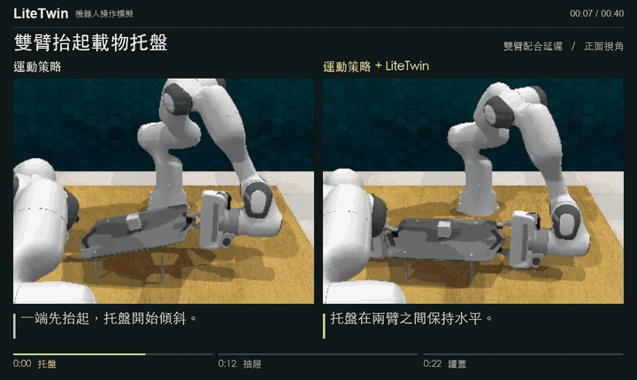](https://yukun-zheng.github.io/LiteTwin/?lang=zh-Hant#film)

這段預覽節錄自三組 RLBench 模擬影片。完整短片中，兩側經歷相同的擾動，依序觀察托盤、抽屜與罐蓋。

[**播放完整短片 →**](https://yukun-zheng.github.io/LiteTwin/?lang=zh-Hant#film) · [單獨開啟 MP4](https://yukun-zheng.github.io/LiteTwin/film/zh-Hant.mp4)

| 章節 | 觀察重點 |
| --- | --- |
| [0:00 · 抬托盤](https://yukun-zheng.github.io/LiteTwin/?lang=zh-Hant#film-tray) | 一隻機械臂先抬起，觀察方塊是否隨托盤升高。 |
| [0:12 · 開抽屜](https://yukun-zheng.github.io/LiteTwin/?lang=zh-Hant#film-drawer) | 夾爪移開時，最上層抽屜有沒有跟著移動？ |
| [0:22 · 蓋罐蓋](https://yukun-zheng.github.io/LiteTwin/?lang=zh-Hant#film-jar) | 首次抓取落空後，跟著灰蓋看它是否抵達紅色罐口。 |

點選時間碼即可進入網站的對應章節，再點「查看本章完整雙側回放」即可檢視原影片與俯視鏡頭。較短的一側結束後停在最後一格。

[並排查看三組結果圖](docs/figures/rollout-comparison.zh-Hant.jpg) · [任務庫](https://yukun-zheng.github.io/LiteTwin/?lang=zh-Hant#library)

<a id="quickstart"></a>

## 快速開始

本機安裝 Git 與 Python 3 後，即可瀏覽全部 13 組配對影片。

```bash
git clone https://github.com/Yukun-Zheng/LiteTwin.git
cd LiteTwin
python3 -m http.server 8000 --directory docs
```

開啟 `http://localhost:8000`。如要從示範軌跡建立模型，並在 RLBench 中執行新的開抽屜回合，請繼續閱讀下方步驟。本次釋出隨附的可重現任務為打開抽屜。

<a id="run-open-drawer"></a>

## 執行打開抽屜範例

### 1. 以五條示範軌跡建立模型

在倉庫根目錄安裝策略環境並執行離線階段。此階段使用隨附的低維軌跡及凍結的運動策略檢查點，可在 CPU 上執行，無須安裝模擬器。

```bash
conda env create -f demo/environment-policy.yml
conda activate litetwin-policy
python -m pip install -e ./code
export LITETWIN_POLICY_PYTHON="$(python -c 'import sys; print(sys.executable)')"
bash demo/run_offline.sh
```

五條軌跡長度不一，但共享三項依序執行的技能。模型得到 **101 個任務狀態**，三項技能分別有 **59、15、27** 個狀態，另有兩個帶條件的技能邊界及一個恢復錨點。可對照[軌跡分段圖](docs/figures/task-structure.zh-Hant.svg)、`outputs/offline/model_summary.json` 及 `outputs/models/litetwin/open_drawer/` 下的模型。

### 2. 執行帶擾動的回合

按照 [Linux 模擬器安裝說明](demo/SETUP.zh-Hant.md) 設定相依元件，然後執行：

```bash
bash demo/run_online.sh open_drawer
```

程式載入建立的模型，在指定種子的 RLBench 場景中引入接觸中斷，檢查擾動是否實際發生、任務是否完成，並在 `outputs/online/` 下儲存連續影片、JSON 結果、逐週期紀錄及時間軸。執行 `bash demo/run.sh open_drawer` 可依序執行兩個階段。重新建立會取代先前的模型與相關的線上輸出。

### 閱讀控制時間軸

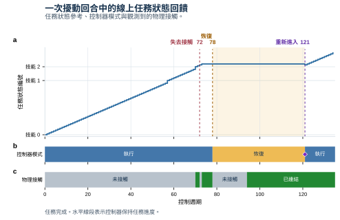

在一次重跑中，第 **72** 個控制週期失去接觸，第 **78** 個週期開始恢復，第 **121** 個週期重新進入受支持的任務狀態，**135** 個週期後模擬器回報成功。上方曲線是指令給出的任務狀態參考，中間色帶是控制器模式，下方色帶是觀測到的物理接觸。水平線表示進度維持。橫軸以控制週期計，影片以播放時間計。[逐週期資料](docs/figures/open-drawer-trace.csv)

## 任務庫

<details><summary>展開全部 12 項任務、13 組配對影片</summary>

示範庫也保留了雙方都完成及雙方都未完成的回合。打開抽屜有兩組影片，擾動不同。下方可重新執行的範例對應接觸中斷的那一組。

<table>
  <tr>
    <td width="33%" align="center"><a href="https://yukun-zheng.github.io/LiteTwin/?lang=zh-Hant#open_drawer">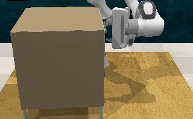<br>打開抽屜</a></td>
    <td width="33%" align="center"><a href="https://yukun-zheng.github.io/LiteTwin/?lang=zh-Hant#insert_square_peg">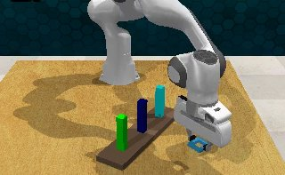<br>方環套柱</a></td>
    <td width="33%" align="center"><a href="https://yukun-zheng.github.io/LiteTwin/?lang=zh-Hant#handover_item">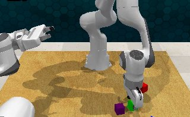<br>雙臂交接物體</a></td>
  </tr>
  <tr>
    <td width="33%" align="center"><a href="https://yukun-zheng.github.io/LiteTwin/?lang=zh-Hant#stack_cups">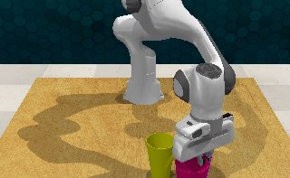<br>堆疊杯子</a></td>
    <td width="33%" align="center"><a href="https://yukun-zheng.github.io/LiteTwin/?lang=zh-Hant#close_jar">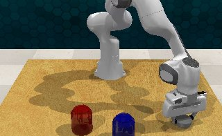<br>蓋上罐蓋</a></td>
    <td width="33%" align="center"><a href="https://yukun-zheng.github.io/LiteTwin/?lang=zh-Hant#place_cups_3">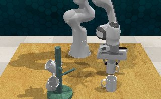<br>掛起三個杯子</a></td>
  </tr>
  <tr>
    <td width="33%" align="center"><a href="https://yukun-zheng.github.io/LiteTwin/?lang=zh-Hant#remove_cups_2">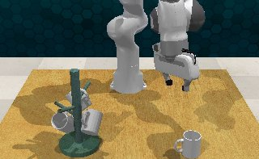<br>取下兩個杯子</a></td>
    <td width="33%" align="center"><a href="https://yukun-zheng.github.io/LiteTwin/?lang=zh-Hant#push_buttons_2">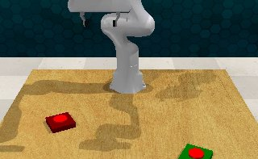<br>按下兩個按鈕</a></td>
    <td width="33%" align="center"><a href="https://yukun-zheng.github.io/LiteTwin/?lang=zh-Hant#sweep_to_dustpan">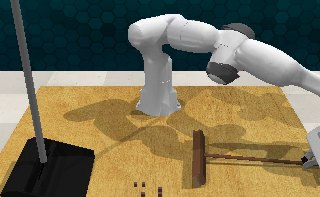<br>單臂清掃</a></td>
  </tr>
  <tr>
    <td width="33%" align="center"><a href="https://yukun-zheng.github.io/LiteTwin/?lang=zh-Hant#bimanual_lift_tray">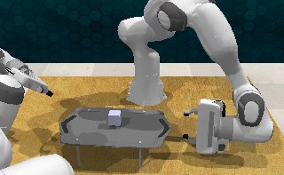<br>雙臂抬托盤</a></td>
    <td width="33%" align="center"><a href="https://yukun-zheng.github.io/LiteTwin/?lang=zh-Hant#bimanual_put_bottle_in_fridge">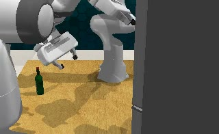<br>把瓶子放進冰箱</a></td>
    <td width="33%" align="center"><a href="https://yukun-zheng.github.io/LiteTwin/?lang=zh-Hant#bimanual_sweep_to_dustpan">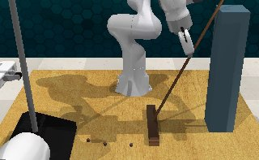<br>雙臂協作清掃</a></td>
  </tr>
</table>

播放器內可單獨開啟全部 [26 段原視角影片](docs/media/)。在倉庫根目錄執行 `python -m http.server 8000 --directory docs`，然後開啟 `http://localhost:8000`。

</details>

## 程式碼結構

[任務模型](code/litetwin/policy/feedback/model/) 從示範中擷取技能邊界、物體關係及場景限制。[推論](code/litetwin/policy/feedback/inference/) 更新進度與關係估計，[控制](code/litetwin/policy/feedback/control/) 決定維持、推進或跨越技能邊界，[恢復](code/litetwin/policy/feedback/recovery/) 負責驗證接觸、重新取得物體及選擇重新進入的狀態。[RLBench 介面](code/integrations/rlbench/rlbench_litetwin/) 連接觀測、擾動及模擬器動作。底層動作參考由凍結的 DynaMAC 運動策略提供。

## 授權條款

LiteTwin 原創程式碼採用 [MIT 授權條款](LICENSE)。外部模擬元件沿用各自的上游授權，詳見[第三方聲明與固定版本](code/integrations/rlbench/THIRD_PARTY.md)。
