<p align="center"><a href="README.md">English</a> &nbsp; · &nbsp; <a href="README.zh-Hans.md">简体中文</a> &nbsp; · &nbsp; <b>繁體中文</b></p>

<p align="center">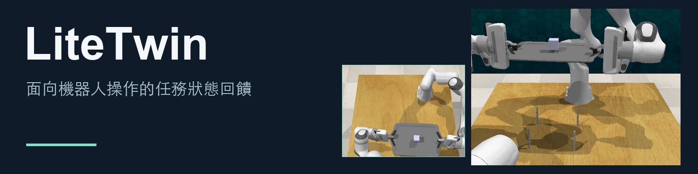</p>

<p align="center"><a href="#demos">觀看演示</a> &nbsp; · &nbsp; <a href="#how-it-works">運作原理</a> &nbsp; · &nbsp; <a href="#quickstart">快速開始</a> &nbsp; · &nbsp; <a href="#code">程式碼</a> &nbsp; · &nbsp; <a href="#license">授權條款</a></p>

LiteTwin 在凍結的運動策略上追蹤任務進度及夾爪與物體的接觸關係。接觸丟失時，它可以保持運動參考、恢復互動，再從受支援的任務狀態繼續執行。

<a id="demos"></a>

## 讓物體真正到達任務目標

以下為精選 RLBench 模擬回合。每組兩側使用相同的起始場景與擾動，結果標註以目前回合的模擬器任務條件為準。

### 雙臂抬托盤

保持方塊在托盤內，雙臂共同抬起。

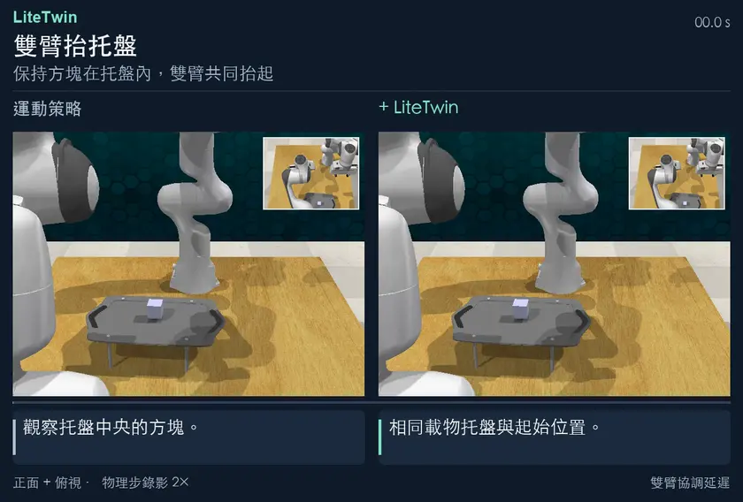

[**完整 MP4 ↗**](https://yukun-zheng.github.io/LiteTwin/demos/bimanual_lift_tray.zh-Hant.mp4) &nbsp; · &nbsp; [原始錄影](docs/recordings/bimanual_lift_tray/) &nbsp; · &nbsp; [JSON](docs/demos/bimanual_lift_tray.json)

### 打開抽屜 · 動作延遲

動作延遲後，仍將最上層抽屜拉開。

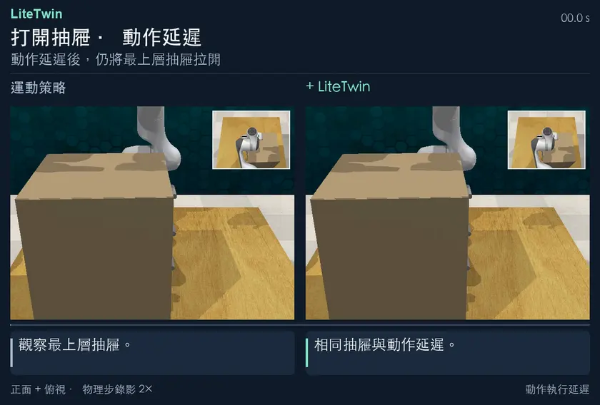

[**完整 MP4 ↗**](https://yukun-zheng.github.io/LiteTwin/demos/open_drawer_delay.zh-Hant.mp4) &nbsp; · &nbsp; [原始錄影](docs/recordings/open_drawer_delay/) &nbsp; · &nbsp; [JSON](docs/demos/open_drawer_delay.json)

### 抓回罐蓋並送至罐口

首次抓取落空後，將灰蓋送到紅色罐口。

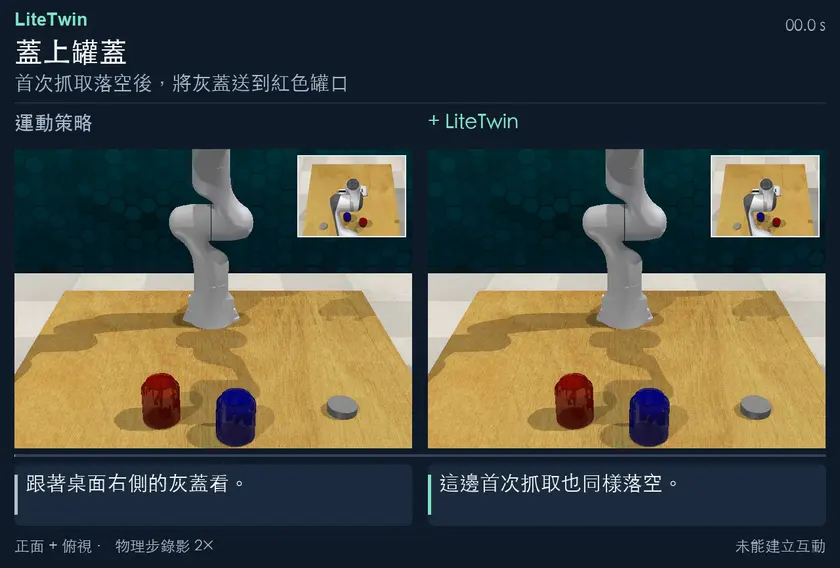

[**完整 MP4 ↗**](https://yukun-zheng.github.io/LiteTwin/demos/close_jar.zh-Hant.mp4) &nbsp; · &nbsp; [原始錄影](docs/recordings/close_jar/) &nbsp; · &nbsp; [JSON](docs/demos/close_jar.json)

每段動圖保留完整記錄動作，結尾用三秒展示記錄終幀的物體局部。較短的一側停在其最後一幀。完整 MP4 保留原始錄影幀率。

## 更多多階段任務

### 掛起三個杯子

將三個杯子依序掛到杯架上。

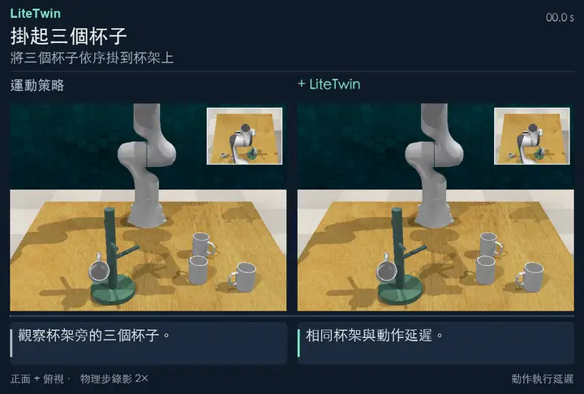

[**完整 MP4 ↗**](https://yukun-zheng.github.io/LiteTwin/demos/place_cups_3.zh-Hant.mp4) &nbsp; · &nbsp; [原始錄影](docs/recordings/place_cups_3/) &nbsp; · &nbsp; [JSON](docs/demos/place_cups_3.json)

### 依序按下三個按鈕

克服動作延遲，依序按下三個按鈕。

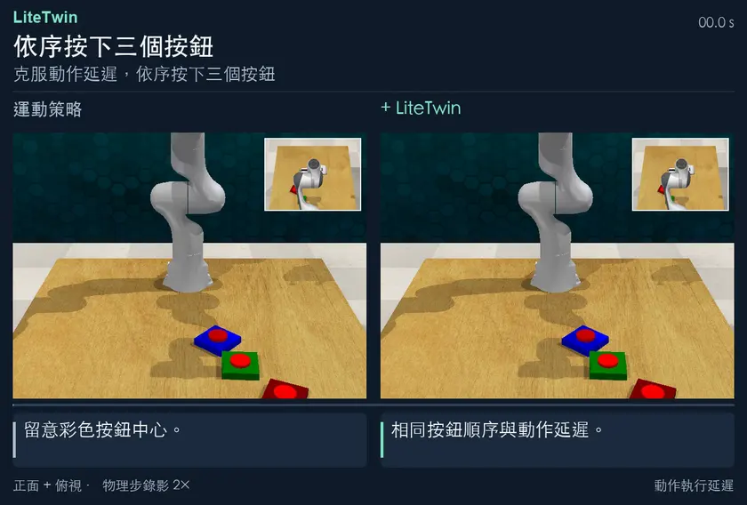

[**完整 MP4 ↗**](https://yukun-zheng.github.io/LiteTwin/demos/push_buttons_3.zh-Hant.mp4) &nbsp; · &nbsp; [原始錄影](docs/recordings/push_buttons_3/) &nbsp; · &nbsp; [JSON](docs/demos/push_buttons_3.json)

### 把瓶子放進冰箱

雙臂配合開門，將綠色瓶子放入冰箱。

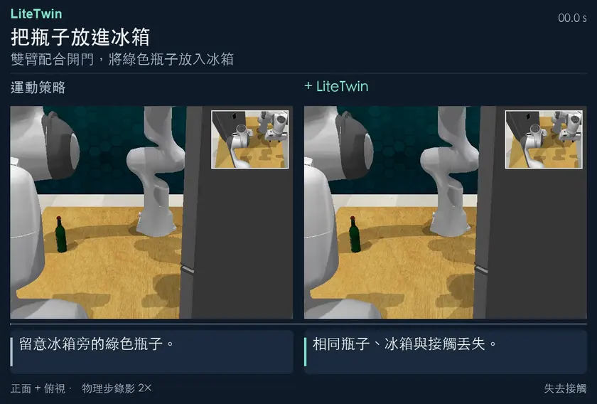

[**完整 MP4 ↗**](https://yukun-zheng.github.io/LiteTwin/demos/bimanual_put_bottle_in_fridge.zh-Hant.mp4) &nbsp; · &nbsp; [原始錄影](docs/recordings/bimanual_put_bottle_in_fridge/) &nbsp; · &nbsp; [JSON](docs/demos/bimanual_put_bottle_in_fridge.json)

<details>
<summary><b>展開另外七組恢復演示</b></summary>

### 雙臂交接物體

雙臂交接綠色方塊。

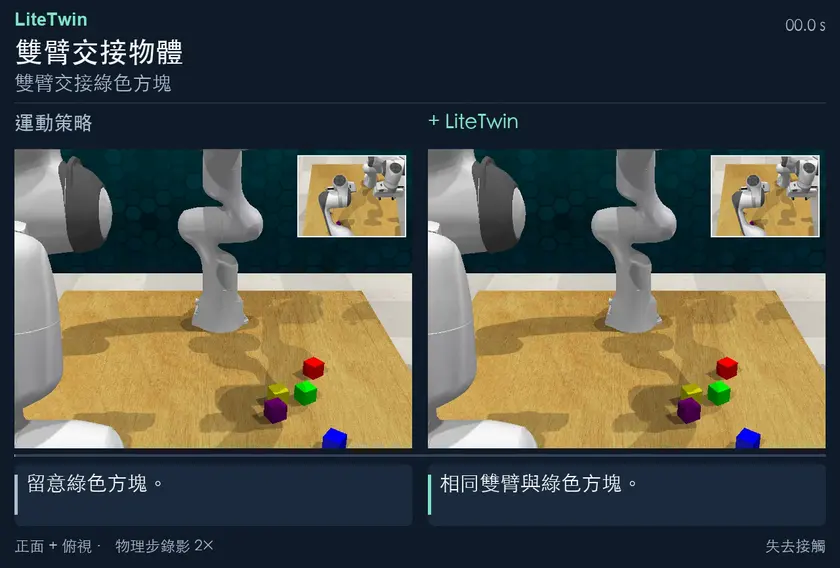

[**完整 MP4 ↗**](https://yukun-zheng.github.io/LiteTwin/demos/handover_item.zh-Hant.mp4) &nbsp; · &nbsp; [原始錄影](docs/recordings/handover_item/) &nbsp; · &nbsp; [JSON](docs/demos/handover_item.json)

### 方環套柱

抓起藍色方環並套到目標柱上。

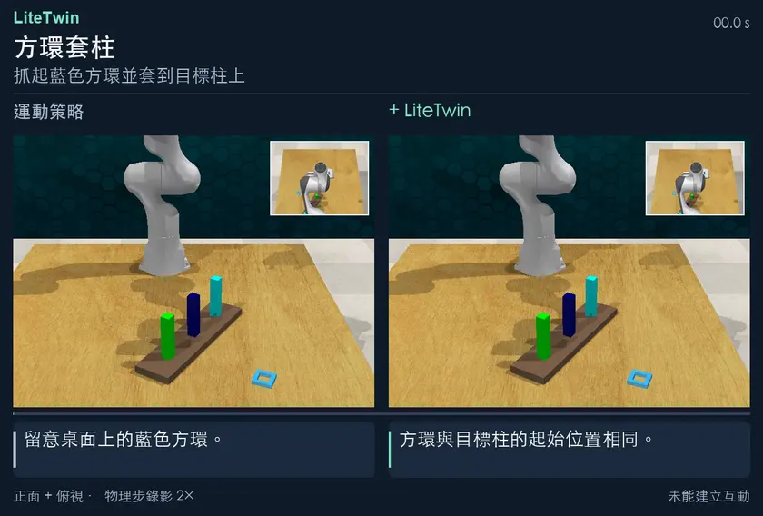

[**完整 MP4 ↗**](https://yukun-zheng.github.io/LiteTwin/demos/insert_square_peg.zh-Hant.mp4) &nbsp; · &nbsp; [原始錄影](docs/recordings/insert_square_peg/) &nbsp; · &nbsp; [JSON](docs/demos/insert_square_peg.json)

### 堆疊杯子

將三個杯子依序疊放。

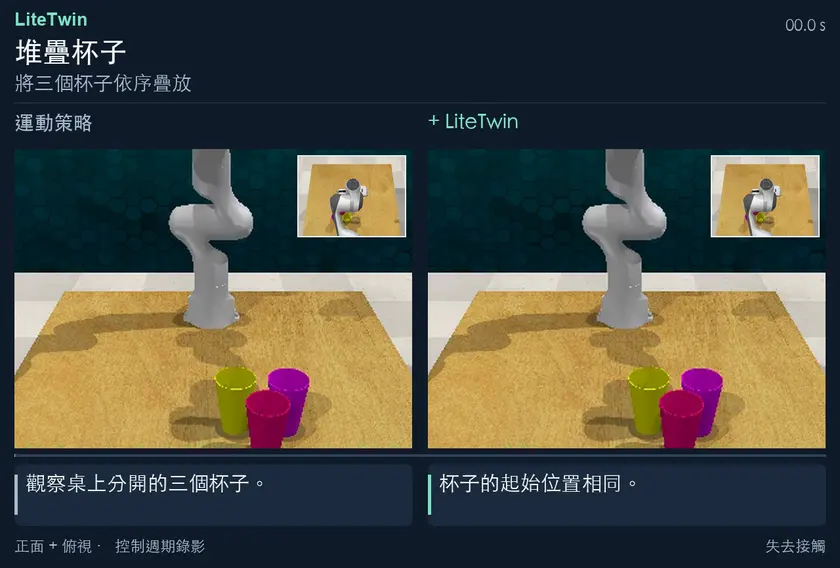

[**完整 MP4 ↗**](https://yukun-zheng.github.io/LiteTwin/demos/stack_cups.zh-Hant.mp4) &nbsp; · &nbsp; [原始錄影](docs/media/stack_cups/) &nbsp; · &nbsp; [JSON](docs/demos/stack_cups.json)

### 取下兩個杯子

場景變化後，將兩個杯子從杯架取下。

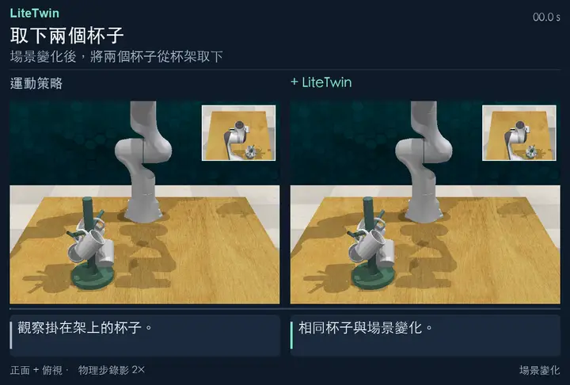

[**完整 MP4 ↗**](https://yukun-zheng.github.io/LiteTwin/demos/remove_cups_2.zh-Hant.mp4) &nbsp; · &nbsp; [原始錄影](docs/recordings/remove_cups_2/) &nbsp; · &nbsp; [JSON](docs/demos/remove_cups_2.json)

### 將碎屑掃入畚箕

恢復掃把抓取，將碎屑掃入畚箕。

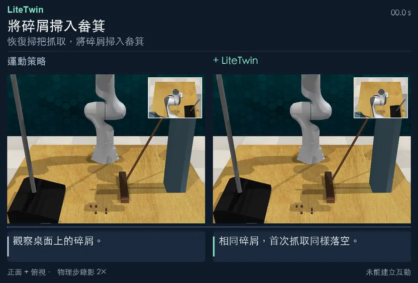

[**完整 MP4 ↗**](https://yukun-zheng.github.io/LiteTwin/demos/sweep_to_dustpan_recovery.zh-Hant.mp4) &nbsp; · &nbsp; [原始錄影](docs/recordings/sweep_to_dustpan_recovery/) &nbsp; · &nbsp; [JSON](docs/demos/sweep_to_dustpan_recovery.json)

### 雙臂協作清掃

恢復掃把抓取，將碎屑掃入畚箕。

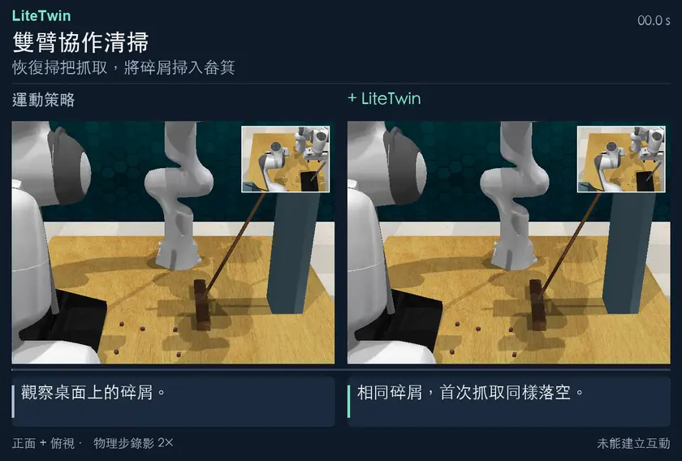

[**完整 MP4 ↗**](https://yukun-zheng.github.io/LiteTwin/demos/bimanual_sweep_to_dustpan.zh-Hant.mp4) &nbsp; · &nbsp; [原始錄影](docs/recordings/bimanual_sweep_to_dustpan/) &nbsp; · &nbsp; [JSON](docs/demos/bimanual_sweep_to_dustpan.json)

### 打開抽屜

接觸丟失後，重新拉動抽屜至目標位置。

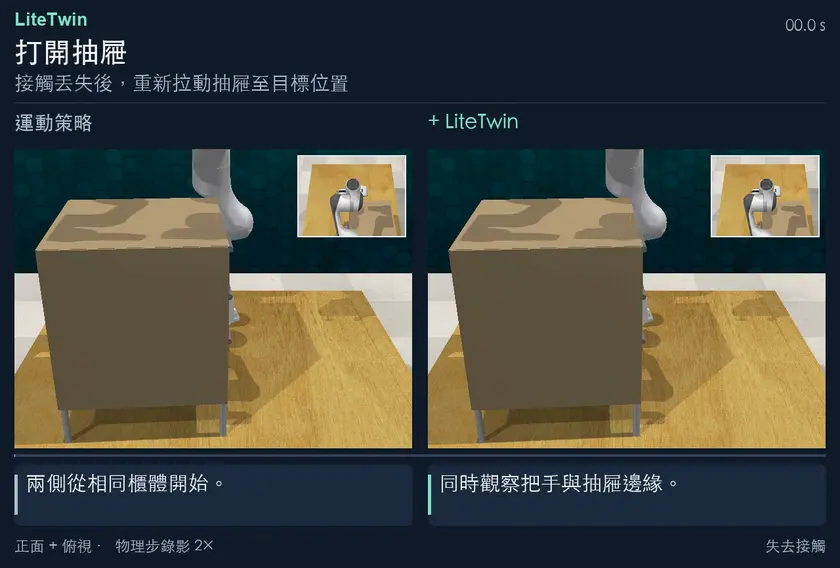

[**完整 MP4 ↗**](https://yukun-zheng.github.io/LiteTwin/demos/open_drawer.zh-Hant.mp4) &nbsp; · &nbsp; [原始錄影](docs/recordings/open_drawer/) &nbsp; · &nbsp; [JSON](docs/demos/open_drawer.json)

</details>

<a id="how-it-works"></a>

## LiteTwin 如何運作

<table>
<tr><td width="33%" valign="top"><b>追蹤任務狀態</b><br><br>從觀測中估計任務進度與接觸關係。</td><td width="33%" valign="top"><b>檢查實際互動</b><br><br>預期互動尚未建立時，保持運動參考。</td><td width="33%" valign="top"><b>恢復後繼續執行</b><br><br>重新建立接觸，從受支援的狀態重新進入任務。</td></tr>
</table>

<a id="quickstart"></a>

## 本機重現

安裝策略環境，使用內附的五條開抽屜演示軌跡建立任務模型。

```bash
git clone https://github.com/Yukun-Zheng/LiteTwin.git
cd LiteTwin
conda env create -f demo/environment-policy.yml
conda activate litetwin-policy
python -m pip install -e ./code
bash demo/run_offline.sh
```

<details>
<summary><b>快速開始 · Open Drawer / RLBench</b></summary>

<a id="run-open-drawer"></a>

## 執行打開抽屜範例

### 1. 以五條示範軌跡建立模型

在倉庫根目錄安裝策略環境並執行離線階段。此階段使用隨附的低維軌跡及凍結的運動策略檢查點，可在 CPU 上執行，無須安裝模擬器。

```bash
conda env create -f demo/environment-policy.yml
conda activate litetwin-policy
python -m pip install -e ./code
export LITETWIN_POLICY_PYTHON="$(python -c 'import sys; print(sys.executable)')"
bash demo/run_offline.sh
```

五條軌跡長度不一，但共享三項依序執行的技能。模型得到 **101 個任務狀態**，三項技能分別有 **59、15、27** 個狀態，另有兩個帶條件的技能邊界及一個恢復錨點。可對照[軌跡分段圖](docs/figures/task-structure.zh-Hant.svg)、`outputs/offline/model_summary.json` 及 `outputs/models/litetwin/open_drawer/` 下的模型。

### 2. 執行帶擾動的回合

按照 [Linux 模擬器安裝說明](demo/SETUP.zh-Hant.md) 設定相依元件，然後執行：

```bash
bash demo/run_online.sh open_drawer
```

程式載入建立的模型，在指定種子的 RLBench 場景中引入接觸中斷，檢查擾動是否實際發生、任務是否完成，並在 `outputs/online/` 下儲存連續影片、JSON 結果、逐週期紀錄及時間軸。執行 `bash demo/run.sh open_drawer` 可依序執行兩個階段。重新建立會取代先前的模型與相關的線上輸出。

### 閱讀控制時間軸


在一次重跑中，第 **72** 個控制週期失去接觸，第 **78** 個週期開始恢復，第 **121** 個週期重新進入受支持的任務狀態，**135** 個週期後模擬器回報成功。上方曲線是指令給出的任務狀態參考，中間色帶是控制器模式，下方色帶是觀測到的物理接觸。水平線表示進度維持。橫軸以控制週期計，影片以播放時間計。[逐週期資料](docs/figures/open-drawer-trace.csv)

</details>

<a id="code"></a>

## 程式碼結構

- [任務模型](code/litetwin/policy/feedback/model/)
- [狀態推斷](code/litetwin/policy/feedback/inference/)
- [執行控制](code/litetwin/policy/feedback/control/)
- [互動恢復](code/litetwin/policy/feedback/recovery/)
- [RLBench 適配層](code/integrations/rlbench/rlbench_litetwin/)

[策略 API](code/litetwin/policy/feedback/README.md) · [DynaMAC](code/litetwin/policy/dynamac.py)

<details>
<summary>錄影識別與結果記錄</summary>

每個任務的 JSON 檔案記錄原影片雜湊、幀數、展示結果及播放副本雜湊。全部動作幀保持原有順序，結尾局部畫面裁切自記錄終幀。

[JSON](docs/demos/)

</details>

<details>
<summary>其他記錄回合</summary>

原始記錄中還保留了雙方都完成的雙按鈕回合，以及雙方都未完成的另一次單臂清掃回合，可結合精選演示一併查看。

### 按下兩個按鈕

依序按下兩個按鈕。

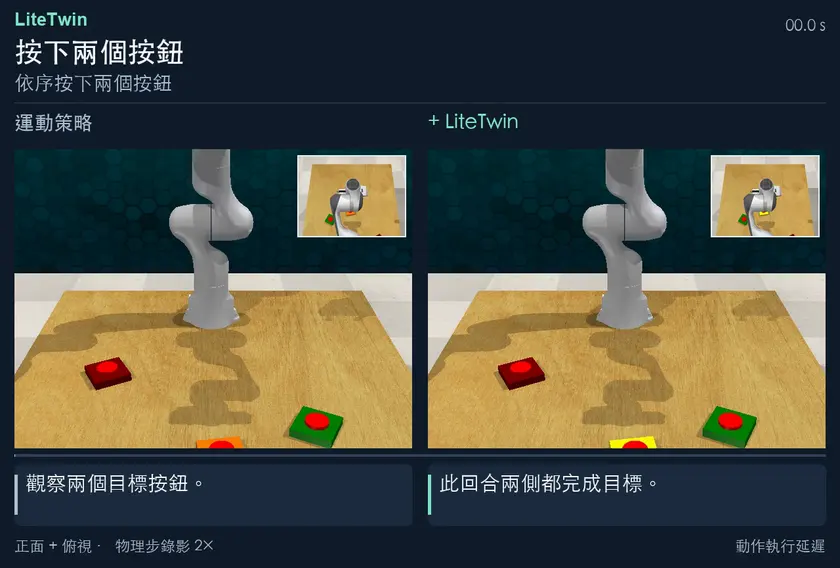

[**完整 MP4 ↗**](https://yukun-zheng.github.io/LiteTwin/demos/push_buttons_2.zh-Hant.mp4) &nbsp; · &nbsp; [原始錄影](docs/recordings/push_buttons_2/) &nbsp; · &nbsp; [JSON](docs/demos/push_buttons_2.json)

### 單臂清掃

將碎屑掃入畚箕。

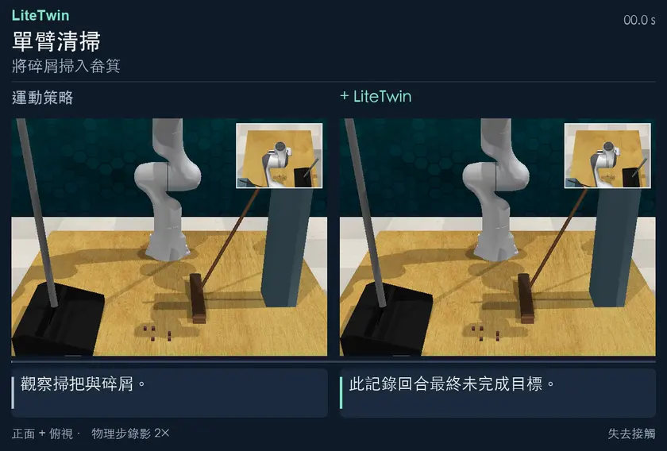

[**完整 MP4 ↗**](https://yukun-zheng.github.io/LiteTwin/demos/sweep_to_dustpan.zh-Hant.mp4) &nbsp; · &nbsp; [原始錄影](docs/recordings/sweep_to_dustpan/) &nbsp; · &nbsp; [JSON](docs/demos/sweep_to_dustpan.json)

</details>

<a id="license"></a>

## 授權條款

LiteTwin 原創程式碼採用 [MIT 授權條款](LICENSE)。外部模擬元件沿用各自的上游授權，詳見[第三方聲明與固定版本](code/integrations/rlbench/THIRD_PARTY.md)。
